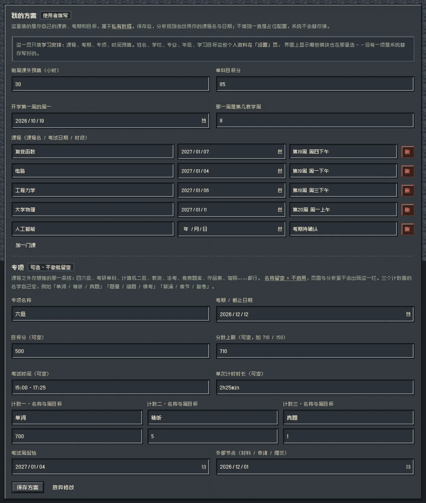
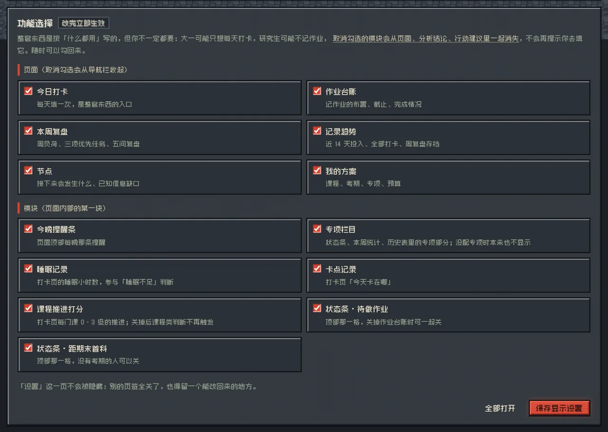
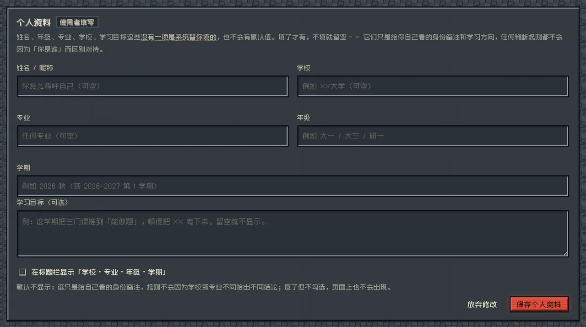

# daily-ledger · 学业台账

> A zero-dependency, single-port study ledger for university students — daily check-in, assignment tracking, weekly review and milestone countdown, plus a rule-based engine that tells you what to do **today**.
>
> 零依赖、单端口、本地优先的大学学习台账。浏览器打开就能用，数据存在你自己的硬盘上。

<p>  
  
  
  
  
</p>

---

## 目录

- [项目简介](#项目简介)
- [界面](#界面)
- [功能特性](#功能特性)
- [环境依赖](#环境依赖)
- [安装](#安装)
- [使用步骤](#使用步骤)
- [示例](#示例)
- [配置说明](#配置说明)
- [访问控制](#访问控制)
- [目录结构](#目录结构)
- [测试](#测试)
- [常见问题](#常见问题)
- [隐私与数据归属](#隐私与数据归属)
- [已知限制](#已知限制)
- [参与贡献](#参与贡献)
- [许可证](#许可证)

---

## 项目简介

大部分学习计划工具死在同一个地方：**它们要求你先制定一份计划，然后靠自律去维护它。**  
`daily-ledger` 反过来——你只记录事实（今天做了什么、作业什么时候交、这周花了多少小时），  
它每天根据这些事实算出一句结论和最多三条行动。

它解决四个具体问题：

| 问题        | 传统做法          | 这个项目的做法                            |
| --------- | ------------- | ---------------------------------- |
| 今天该干什么    | 打开长长的待办清单，挑一个 | 规则引擎按「逾期 → 临近截止 → 预算 → 断层」排序，直接给结论 |
| 作业什么时候交   | 记在备忘录里，想起来才看  | 作业台账按截止日排序，逾期会挤掉其他所有建议             |
| 这周到底投入了多少 | 凭感觉           | 按课程、按天汇总，超预算 / 落后节奏当场指出            |
| 期末什么时候考   | 到期末才慌         | 节点页列出考试日期与倒计时，同周拥挤会提前预警            |

**技术上有三个刻意的选择：**

1. **零依赖。** `package.json` 里没有 `dependencies`，也不存在 `node_modules`。  
   没有构建步骤，克隆下来直接 `node core/server.js` 就能跑，不会因为依赖装不上而启动失败。
2. **单端口。** 页面、接口、静态资源全在同一个 HTTP 端口上，不需要反向代理、不需要前端 dev server。
3. **同构的领域层。** `core/domain/` 是纯函数，浏览器 `import` 它，Node 也 `import` 同一个文件。  
   同一套规则不会在页面和服务端各写一遍，测试直接对着它跑。

---

## 界面

四套主题共用同一套骨架：换主题只换 CSS 令牌，页签位置、卡片高度、柱宽一概不动。







截图里的课程名是占位（课程一 / 课程二 / 课程三），公用代码里没有任何真实姓名、学校、课程或日期。

---

## 功能特性

### 记录

- **今日打卡** — 每天填一次：投入小时、睡眠、每门课的推进等级（0–3）、今天卡在哪。
- **作业台账** — 布置了什么、什么时候交、做没做、预计与实做工时、得分。逾期高亮并优先进分析。
- **本周复盘** — 周负荷、三项优先任务、五问复盘（本周进展 / 卡点 / 原因 / 下周打算）。
- **记录趋势** — 近 14 天投入曲线、全部打卡历史、周复盘存档。
- **节点** — 考试周起始、外部材料节点、里程碑倒计时。
- **我的方案** — 课程与考期、单科目标分、每周预算、专项（第二条战线）配置。

### 分析引擎（`core/domain/rules.js`，唯一实现）

每天跑一遍，输出「结论 + 最多三条行动」。已实现的判断：

- 作业逾期 / 今明两天要交 / 今天已清掉几项
- 本周超预算、进度落后于本周节奏、节奏正常
- 睡眠不足 6 小时、睡眠到位
- 有课程从未开始、某门课连续 N 天没推进（课程断层）
- 期末多门课挤在同一周
- 专项（如语言考试、竞赛、作品集）本周缺口、目标分差距、倒计时
- 连续多天没有完整休息、单日投入接近透支
- 投入方向偏差（在写作业但课程还没诊断过）、项目停在候选阶段

规则是纯函数：`buildAnalysis(db, profile, records, today, ui)` —— 不读全局、不碰 DOM、不读系统时间，  
`today` 由调用方传入。所以它能被单测逐字比对，也能被服务端复用。

### 界面开关（显示什么也归使用者）

不同人用得到的功能不一样：大一新生可能只想每天打卡，研究生不记作业只记进度，脱产备考的人没有课程表。  
所以**页签和模块都能关**，配置存在 `profile.ui`：

- 6 个业务页签 + 7 个模块，缺省全开，显式 `false` 才算关。
- **设置页永远关不掉**——否则把页签全关掉就再也找不回来。
- **关掉 ≠ 藏起来**：被关模块的规则同样会跳过，不会第二天照旧催你。
- 清单只写在 `core/domain/ui.js`，页面、规则、测试三处都从这里读。

### 外观主题（四套配色，自由切换）

配色不是写死在 CSS 里的，而是**一层 CSS 变量（令牌）**。设置页可以随时换，换完刷新还在：

| 主题 | 观感 |
| --- | --- |
| 圆石 · 书页 | 暖米色纸面 + 石砌块，默认 |
| 下界 · 熔岩 | 深底 + 余烬橙，夜间用不刺眼 |
| 雪原 · 云杉 | 冷白 + 松绿，白天亮环境下清晰 |
| 沙漠 · 砂岩 | 土黄 + 砂岩纹，偏暖 |

主题**只覆盖颜色令牌与底纹，不碰任何尺寸与结构选择器**——所以换主题不会重排页面，
测试里有一条专门盯着这件事（换主题前后比卡片宽度与页签高度）。

主题存 `profile.appearance.theme`，与布尔开关表 `profile.ui` 分开存放：那一段全是 true/false，
混进字符串会让「全部打开」的语义变糊。

### 数据与同步

- **本地优先**：数据是 `private/` 下的 JSON 文件，随时可以拷走、备份、放进自己的私有仓库。
- **按条合并**：客户端提交时带上 `baseUpdatedAt`。底稿一致就直接覆盖；不一致就按日期键、周键、作业 id  
  逐条合并（有 `ts` 就新者胜），再回传合并结果。手机记今天、电脑补昨天，不会互相抹掉。
- **空提交保护**：磁盘上有记录、提交的却是整份空数据时，拒绝抹除，改为合并。
- **不需要数据库**：没有 SQLite、没有 Docker、没有后台进程。

### 传输

- `Cache-Control` 按资源分级：字体 30 天、JS/CSS/HTML `no-cache` + `ETag`（命中走 304）。
- gzip 结果按「路径 + mtime + size」缓存在内存里，`Vary: Accept-Encoding` 保证中间缓存不串味。
- **不附带字体文件**：界面声明了像素字体但不分发它（版权原因），装了 Zpix 的机器自动用上，
  没装就回退系统字体，零网络请求。整个仓库因此只有约 500 KB。

### 运维（可选）

- `launch.js` 启动器：单实例锁、看门狗（30 秒探一次，连续 3 次失败重启服务）、局域网地址变化检测。
- `healthcheck.js` 守护：服务挂了自动重新拉起；`stop-silent.vbs` 会先写暂停标记，所以停了不会又被拉起来。
- `notify.js` 多通道推送：ntfy / Bark / PushPlus / Server酱 / 自定义 webhook，全部零依赖。
- 网页管理台 `/admin.html`：服务状态、数据条数、启动器与隧道状态、日志尾巴。
- 可选公网隧道（默认关闭，见 [配置说明](#配置说明)）。

---

## 环境依赖

| 项目      | 要求                      | 说明                                                 |
| ------- | ----------------------- | -------------------------------------------------- |
| Node.js | **≥ 18**                | 只用到内置模块（`http` / `fs` / `crypto` / `zlib`），不需要装任何包 |
| 操作系统    | Windows / macOS / Linux | Windows 额外提供了双击启动与开机自启脚本；其他系统用命令行                  |
| 浏览器     | 支持 ES Modules 的现代浏览器    | Chrome / Edge / Firefox / Safari 近两年版本均可           |

> **不需要** `npm install`，**不需要** 构建，**不需要** 数据库，**不需要** Docker。  
> 也不支持 `file://` 双击打开 HTML —— 因为用了 ES Modules，必须通过 HTTP 访问，这是有意设计。

---

## 安装

### 方式一：源码运行（任意系统，需要 Node.js）

```bash
git clone https://github.com/<你的账号>/daily-ledger.git
cd daily-ledger
npm start
```

不想装 git 也可以直接在仓库页点 **Code → Download ZIP**，解压后同样能跑。

看到下面的输出就成功了：

```
daily-ledger on 127.0.0.1:3000
access 需要口令；本机打开 http://127.0.0.1:3000/?k=x7Kd2mQpR4tWn8Hb
口令 首次运行，已自动生成口令并写入 .../private/config.json
```

第一次启动会自动生成一个 16 位口令写进 `private/config.json`，日志里直接给带口令的地址，
**照那条打开即可**（打开一次种 30 天 Cookie，之后裸地址也能进）。不想要口令见下文
[访问控制](#访问控制)。

`npm start` 等价于 `node core/server.js`，默认只监听 `127.0.0.1`（只有本机能访问）——这是保守的默认值。

### 方式二：Windows 便携版（对方不需要装 Node）

整个文件夹是自包含的，脚本里没有任何写死的用户名或盘符：

```bat
:: 在项目根目录双击，或命令行执行
make-portable.bat
```

它会把本机的 `node.exe` 复制到 `runtime\node.exe`。之后把这个文件夹打包发给别人，  
对方解压后双击 `start.bat` 就能跑，**机器上没装 Node 也可以**。

启动器查找 `node.exe` 的顺序：

1. `runtime\node.exe`（便携捆绑，优先级最高）
2. 系统 `PATH` 里的 `node`（`where node`）
3. `%ProgramFiles%\nodejs\node.exe`

### 方式三：Windows 静默启动 + 开机自启

| 脚本                        | 作用                        |
| ------------------------- | ------------------------- |
| `start.bat`               | 后台静默启动服务 + 守护进程，不弹黑框      |
| `stop-silent.vbs`         | 停止全部相关进程，并写暂停标记（守护不会又拉起来） |
| `install-autostart.bat`   | 装到「启动」文件夹，登录后约 20 秒静默拉起   |
| `uninstall-autostart.bat` | 卸载自启                      |


---

## 使用步骤

### 第 1 步：填「我的方案」

打开页面 → 顶部导航 **我的方案**。这里填的是**你自己的**课表和目标：

- **每周课外预算**（小时）— 用来判断「本周已超预算」。
- **单科目标分** — 用来算离目标还差多少。
- **开学第一周的周一 + 那是第几教学周** — 所有「第 N 周」的口径从这里推。
- **课程列表** — 课程名、考试日期、考试时段。考期决定倒计时和「期末挤压」判断。
- **专项**（可选）— 课程之外的第二战线：语言考试、竞赛、作品集…… 三个计数器名字由你起  
  （比如「单词 / 精听 / 真题」），名称留空就整块不显示。

> 保存后会立刻生效：顶部的倒计时、课程断层、期末挤压判断都会改用新值，不需要改代码。

### 第 2 步：每天打卡

**今日打卡** 页填四个数：投入小时、睡眠、每门课推进了几级、今天卡在哪。十秒钟能填完。

### 第 3 步：记作业

**作业台账** 页加一条：课程 + 标题 + 截止日。标题写具体点——「第 5 章习题 3/7/11」比「作业」有用得多。  
截止日一过就会标红，并挤掉其他所有分析建议。

### 第 4 步：每周复盘

**本周复盘** 页在周末填一次：本周投入、三项优先任务、五问复盘。这是唯一需要静下心写的地方。

### 第 5 步（可选）：改「设置」

**设置** 页做两件事：

1. **个人资料** — 姓名、学校、专业、年级、学期、学习目标。**全部默认为空**，填什么显示什么，不填就不显示。  
   公用代码里没有任何预置值，不会拿别人的名字冒充你的。
2. **功能选择** — 勾掉你用不到的页签和模块。

---

## 示例

### 示例 1：一条典型的分析输出

假设今天是周四，你有 3 项作业逾期、本周已投入 16 小时（预算 15），某门课 7 天没推进。  
`GET /api/analysis?date=2026-10-22` 返回的结论大致是：

```
有 3 项作业已逾期                       ← 逾期永远排第一
本周已超预算   16h / 15h                ← 预算判断
高频课「X」已 7 天没推进                ← 课程断层
```

行动最多三条，按优先级取前面几条，不会给你一张二十项的清单。

### 示例 2：用命令行跑一次分析

```bash
# 读整份记录（需要口令时加 Cookie 或 ?k=）
curl http://127.0.0.1:3000/api/analysis?date=2026-10-22

# 健康检查：无口令时只返回条数的模糊值
curl http://127.0.0.1:3000/api/health
# {"ok":true,"mode":"open","days":12,"weeks":3,"assignments":8,...}
```

### 示例 3：换端口 / 换私有目录跑第二份数据

```bash
# macOS / Linux
PORT=4000 LEDGER_PRIVATE_DIR=~/ledger-b node core/server.js

# Windows PowerShell
$env:PORT=4000; $env:LEDGER_PRIVATE_DIR="$HOME\ledger-b"; node core/server.js
```

一个进程对应一个 `private/` 目录——想做多份数据就起多个进程，而不是在一个进程里塞多租户。

### 示例 4：给定时任务用的推送

```bash
node notify.js          # 自检：逐个渠道打印 HTTP 状态码
```

渠道配置写在 `private/config.json` 的 `notify` 段里，支持 ntfy、Bark、PushPlus、Server酱 和自定义 webhook。

---

## 配置说明

### 环境变量

| 变量                   | 默认值                                                    | 作用                                   |
| -------------------- | ------------------------------------------------------ | ------------------------------------ |
| `PORT`               | `3000`                                                 | HTTP 端口                              |
| `LEDGER_HOST`        | `core/server.js` 为 `127.0.0.1`；`launch.js` 为 `0.0.0.0` | 监听地址。`0.0.0.0` = 局域网可访问              |
| `LEDGER_PRIVATE_DIR` | `<项目>/private`                                         | 私有数据目录，可指向任意位置                       |
| `LEDGER_TOKEN`       | 读 `private/config.json` 的 `token`                      | 访问口令，优先级高于配置文件                       |
| `LEDGER_OPEN`        | 未设                                                     | 设为 `1` 才允许**开放模式**（无口令），见下方访问控制   |
| `LEDGER_TUNNEL`      | 关闭                                                     | 设为 `1` 时由 `launch.js` 建立公网隧道         |
| `LEDGER_NO_TUNNEL`   | 未设                                                     | 设为 `1` 强制禁用隧道（优先级高于 `LEDGER_TUNNEL`） |

> 两个启动入口的默认监听地址不同，是刻意的：单跑服务时保守（只有本机），  
> 双击 `start.bat` 时方便（同 WiFi 的手机能直接连）。改之前先想清楚要让谁能连。

### 私有数据文件（`private/`）

| 文件               | 内容                           |
| ---------------- | ---------------------------- |
| `profile.json`   | 我的方案：课程、考期、目标、里程碑、周任务、界面开关   |
| `records.json`   | 我的记录：打卡、周复盘、作业               |
| `config.json`    | 访问口令（`token`）、推送渠道（`notify`） |
| `brief.json`     | 当晚提醒正文（由定时任务写入，纯数据）          |
| `tunnel-url.txt` | 当前地址，含带口令的完整链接               |

首次启动时这些文件会自动创建。**这个目录不要提交到任何公开仓库**——随包附带的 `.gitignore`  
已经排除了它。

### 自定义方案（不改代码）

想把默认课程换掉，改 `core/default-profile.json` 就行：它是公开的占位方案，  
任何使用者克隆下来改这一个文件即可上手，不会看到别人的任何数据。

---

## 访问控制

服务端把请求分成三档，这是「能不能公开到公网」的关键：

| 路径                                         | 是否公开       | 说明                                         |
| ------------------------------------------ | ---------- | ------------------------------------------ |
| `/`、`/index.html`、`/app.css`、`/app.js`     | 公开         | 只有通用界面，拿到也看不到个人数据                          |
| `/domain/*`                                | 公开         | 共享模块，只含规则与工具                               |
| `/api/health`                              | 公开（分档返回）   | 有口令返回条数与方案来源；无口令全部返回 `-1` 和 `hidden`       |
| `/api/data`、`/api/profile`、`/api/analysis` | **需口令**    | 无口令 401                                    |
| `/profile.js`、`/brief.js`                  | **需口令**    | 无口令返回 `window.__AUTH__ = false`，页面提示「没有权限」 |
| `/private/*`、`../private/*`                | **一律 403** | 静态目录不覆盖私有目录，路径穿越也拦住                        |

口令机制：

1. 口令来源按优先级：环境变量 `LEDGER_TOKEN` → `private/config.json` 的 `token` → **首次运行自动生成**并写回 `config.json`。
2. 第一次用 `http://<地址>:3000/?k=<token>` 打开，服务端种一个 **30 天 HttpOnly Cookie**，之后不用再带参数。
3. 比对用 `crypto.timingSafeEqual`，不泄露「第几位开始不同」。
4. 同一来源 10 分钟内错 30 次 → 锁 10 分钟（429）。**口令正确的人不受连坐**——先认口令再谈封禁。
5. `Cookie` 的 `Secure` 只在确实走了 HTTPS 时添加（否则本地 http 下 cookie 根本发不出去）。
6. **默认不开放**：没有任何口令配置时会自动生成一个，而不是裸奔。真要开放（本机自用、或给人试用空库），
   显式 `LEDGER_OPEN=1` 启动；此时启动日志会写 `access 开放模式`。
7. 换口令：改 `config.json` 的 `token` 后**重启服务**——口令只在启动时读一次进内存。
   删掉 `token` 字段的效果是「下次启动重新生成一个」，不是变成开放模式。

---


## 目录结构

```
daily-ledger/
├─ core/                        公用层：可以整份发给别人
│  ├─ domain/                   纯函数领域层 —— 页面、服务端、测试共用同一份
│  │  ├─ rules.js               分析规则唯一实现 buildAnalysis()
│  │  ├─ stats.js               周投入 / 课程断层 / 连续无休 / 作业状态
│  │  ├─ schema.js              空库、归一化、合并、校验
│  │  ├─ focus.js               专项（第二条战线）归一化
│  │  ├─ ui.js                  页签与模块清单（界面开关的唯一来源）
│  │  ├─ theme.js               四套配色清单（外观主题的唯一来源）
│  │  ├─ dates.js               日期算术
│  │  └─ text.js                esc / stripTags
│  ├─ server.js                 静态页 + 数据接口 + 访问控制（零依赖 http 服务）
│  ├─ web/                      通用界面，代码里没有任何个人常量
│  │  ├─ index.html             结构
│  │  ├─ app.css                样式（像素字体走 local()，不分发字体文件）
│  │  ├─ app.js                 渲染与交互（import domain）
│  │  ├─ admin.html             网页管理台
│  │  └─ textures/              四套主题的底纹（cobble / basalt / snow / sand）
│  ├─ default-profile.json      公开占位方案
│  └─ package.json              "type": "module"
│
├─ private/                     私有层（本地生成，不进仓库）
├─ test/                        规则回归 + 接口契约 + 浏览器冒烟 + 界面开关
├─ tools/make-textures.mjs      重新生成四套底纹（改动才需要跑）
├─ docs/
│  ├─ ARCHITECTURE.md           架构说明：为什么要分两层
│  ├─ USAGE.md                  使用手册（更细的操作说明）
│  └─ RELEASING.md              发布与版本管理流程
├─ runtime/                     便携运行时的 node.exe 放这里
├─ launch.js                    启动器：本地服务 + 看门狗 + 可选隧道
├─ healthcheck.js               守护进程：服务挂了自动拉起
├─ notify.js                    多通道推送（零依赖）
├─ start.bat / start-silent.vbs Windows 双击 / 静默启动
├─ stop-silent.vbs              停止并暂停
├─ install-autostart.bat        开机自启安装
├─ make-portable.bat            把 node.exe 打进 runtime/
├─ package.json
├─ LICENSE
└─ README.md
```

---

## 测试

```bash
npm test         # 27 个用例：规则逐字比对基线 + 合并语义 + 界面开关
npm run api      # 12 项接口契约：并发合并、空提交、413、429、畸形 URL
npm run smoke    # 12 项浏览器冒烟（真 Chrome）：样式、模块、字体、页签
npm run ui       # 13 项界面开关：勾掉当场收起、写盘、刷新还在、规则不再提、四套主题可换
npm run verify   # 以上全部，共 64 项
```

几点说明：

- `npm test` 和 `npm run api` **不需要** 服务在跑，也不需要浏览器。
- `npm run smoke` / `npm run ui` 会自己起临时实例、用真实 Chrome 跑，**绝不碰 `private/` 里的真实数据**。
- 规则测试用的是「先固化行为、再重构」的做法：`test/golden/analysis.json` 是逐字基线，  
  改规则时必须同步重新生成，diff 就是这次改动的全部影响面。

---

## 常见问题

**Q：能不能直接双击 `index.html` 打开？**  
不能。页面用的是 ES Modules，浏览器同源策略会拦住 `file://` 下的模块加载。必须通过 HTTP 访问——这是设计取舍，不是 bug。

**Q：数据存在哪？会不会上传到什么地方？**  
全部存在 `private/` 目录下的 JSON 文件里，没有任何出站请求（除非你自己在 `notify` 里配了推送渠道）。  
项目没有账号体系、没有云同步、没有埋点。

**Q：怎么备份？**  
把 `private/` 整个目录拷走即可。界面里也有导出功能。

**Q：手机怎么访问？**  
`launch.js`（`start.bat`）默认监听 `0.0.0.0`，同一 WiFi 下用 `http://<电脑内网IP>:3000/?k=<口令>` 打开一次即可。  
地址写在 `private/tunnel-url.txt`，管理台也能看到。注意内网 IP 会随 WiFi 变化。

**Q：不在同一 WiFi 时怎么办？**  
设 `LEDGER_TUNNEL=1` 再启动，`launch.js` 会建一条隧道并写出公网地址。  
免费隧道地址每次重连都会变，且数据经第三方中转——**只适合临时从外网看一眼，不适合当日常入口**。

**Q：多个设备同时编辑会丢数据吗？**  
不会互相抹掉。服务端按日期键、周键、作业 id 合并，有 `ts` 就新者胜。  
但**删除不会传播**（合并求并集，另一端会把删掉的一条带回来），这是已知限制。

**Q：能多人一起用吗？**  
不能。整套是单用户单口令。要做多用户得先有用户表和会话，属于换架构。

**Q：Windows 上双击 `start.bat` 没反应？**  
它是静默启动，本来就不弹窗。去管理台 `/admin.html` 或看项目根目录的 `launch.log`、`health.log`。  
如果提示找不到 node，先跑一次 `make-portable.bat`，或者装一个 Node.js ≥ 18。

---

## 隐私与数据归属

这个项目从架构上就假设「代码会公开、数据绝不公开」，所以拆成了两层：

|          | 公用层 `core/`        | 私有层 `private/`       |
| -------- | ------------------ | -------------------- |
| 内容       | 界面、规则、接口、字段结构、占位方案 | 真实姓名、课程、考期、记录、口令     |
| 能否给别人    | 能，整个目录拷走即可用        | 任何情况下都不外发            |
| 会进 git 吗 | 会                  | 不会（`.gitignore` 已排除） |

一条硬规则：**`core/` 里不许出现真实课程名、真实日期、真实姓名。**  
判断标准只有一句：换一个人来用，这条内容还要不要变？要变 → 公用；只对我成立 → 私有。

个人资料字段（姓名 / 学校 / 专业 / 年级 / 学期 / 目标）在公用配置里**全部为空串**，  
只在「设置」页由使用者自己填写。默认值会冒充使用者的输入，所以干脆不设默认值。

---

## 已知限制

1. **口令是唯一凭证**，没有账号体系。地址 + 口令一起泄露就等于全公开。用完关掉服务仍是最有效的锁。
2. **数据只有一份**，在 `private/records.json`。分层解决的是「谁能看」，不解决「丢了怎么办」——定期导出仍是必须的。
3. **删除不传播**：合并求并集，需要墓碑机制才能真正删除，成本高于收益，暂不实现。
4. **单实例假设**：一个进程对应一个 `private/`。多份数据靠 `LEDGER_PRIVATE_DIR` 起多个进程。
5. **里程碑与周任务不能在界面手改**，它们是规划判断的产物，手改容易和规则脱节。
6. **`file://` 不可用**（见常见问题）。
7. **公网隧道地址会变**，且数据经第三方中转。

---

## 参与贡献

1. Fork 并新建分支：`git checkout -b feat/your-feature`
2. 改完跑一遍：`npm run verify`（64 项必须全绿）
3. 如果动了 `core/domain/rules.js` 的判断逻辑，必须同步重新生成 `test/golden/analysis.json`，  
   并在 PR 说明里写清楚 diff 覆盖了哪几条规则。
4. 提交 PR。

界面文案和行为只改一处：页签与模块清单在 `core/domain/ui.js`，规则在 `core/domain/rules.js`，  
不要在页面里再抄一份。

**要发版的话**，完整流程在 [docs/RELEASING.md](docs/RELEASING.md)：版本号怎么加、
CHANGELOG 怎么写、发布包怎么打、发出去之后怎么通知用户。

---

## 许可证

代码以 **MIT License** 发布，详见 [LICENSE](LICENSE)。

**项目不包含任何第三方字体文件。** 界面引用了像素字体 Zpix（作者 SolidZORO），  
但只通过 CSS `local()` 引用——本机装了就用、没装就回退系统字体，既不分发也不打包。  
想恢复像素外观自己装一份 Zpix 即可；商业使用请自行向字体作者取得授权。详见 [NOTICE.md](NOTICE.md)。

---

## 致谢

- 像素字体 [Zpix / 最像素](https://github.com/SolidZORO/zpix-pixel-font) by SolidZORO
  （本项目仅做可选引用，不分发其文件）。
- 规则引擎的阈值来自真实使用中的反复校准，不是拍脑袋定的。
